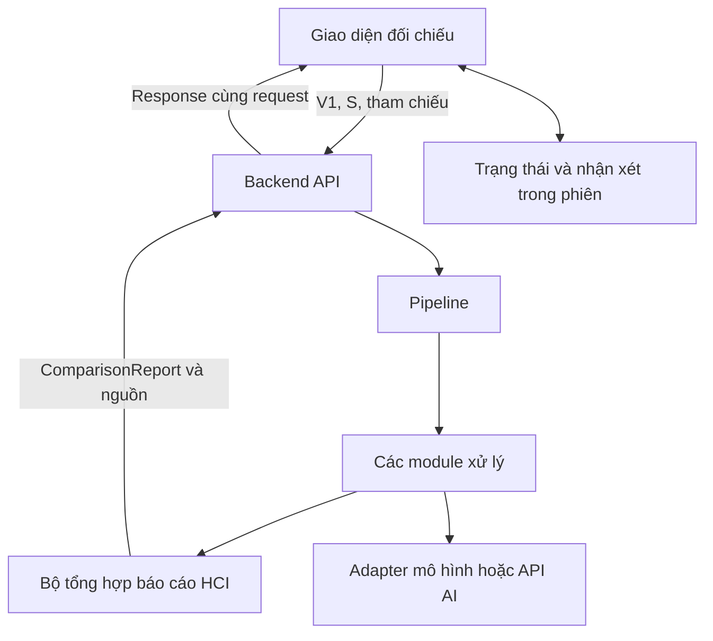

# Architecture — Kiến trúc hệ thống HCI

**Học phần và nhóm:** 2627I_INT2041_1 Nhóm 6  
**Dự án:** Legal Document Change Detection  
**Nhóm trưởng:** Bạch Công Dũng  
**Thành viên:** Bạch Công Dũng, Dương Đức Anh, Lê Tùng Dương, Vương Thành Nam  
**Phiên bản:** HCI 1.0.0  
**Ngày cập nhật:** 16/10/2026  
**Tài liệu liên quan:** [BRD](brd.md), [SRS](srs.md), [Nghiên cứu người dùng](user-research.md)

## 1. Lựa chọn kiến trúc

Ứng dụng gồm một frontend và một backend Python chia module. Backend xử lý V1, S và các tài liệu tham chiếu trong cùng request đồng bộ rồi trả báo cáo. Frontend giữ file, báo cáo và nhận xét trong phiên để người dùng kiểm chứng, bổ sung tài liệu và phân tích lại.

Phần nghiệp vụ và phạm vi theo BRD; yêu cầu, tên trường và trạng thái theo SRS 1.0.0. Architecture chỉ quy định trách nhiệm thành phần, luồng và điểm phối hợp. Các thành phần dưới đây là thiết kế mục tiêu, không xác nhận đã có mã chạy được.

| Thành phần | Lựa chọn bản đầu | Mục đích |
| --- | --- | --- |
| Frontend | React và TypeScript | Hiển thị đối chiếu, bằng chứng, trạng thái và quản lý nhận xét trong phiên |
| Backend | Python và FastAPI | Nhận file, kiểm tra, điều phối và trả báo cáo |
| Đọc tài liệu | python-docx cho DOCX; PyMuPDF cho PDF có lớp chữ | Trích nội dung và giữ vị trí nguồn; kiểm tra thêm khả năng giữ bảng trên mẫu thực tế |
| Phân tích AI | Adapter cho mô hình/API có sẵn; mô hình cụ thể chốt sau thử mẫu | Cô lập việc gọi mô hình, kiểm tra đầu ra và giới hạn lỗi |
| Lưu trữ | Bộ nhớ frontend và file tạm backend | Phục vụ phiên sử dụng, không cần database hoặc lịch sử dài hạn |

Bản đầu không cần Queue/Worker, API polling, kho pháp luật hoặc RAG. Lựa chọn đồng bộ giúp giảm hạ tầng cho demo; thời gian xử lý vẫn phải đo và đặt giới hạn.

## 2. Thành phần và ranh giới trách nhiệm

Các module xử lý gọi nhau qua hàm và kiểu dữ liệu nội bộ, không gọi HTTP lẫn nhau. Pipeline điều phối và giữ lỗi; bộ tổng hợp chuyển đầu ra nội bộ thành hợp đồng HCI. Nhận xét của người dùng được frontend quản lý, không đưa ngược vào AI như đáp án đúng.

| Thành phần | Trách nhiệm chính | Điểm bàn giao |
| --- | --- | --- |
| Reader và Parser | Đọc từng tài liệu, giữ thứ tự, Khoản/Điểm, bảng đọc được và vị trí nguồn; tách cấu trúc cần thiết | Nội dung có cấu trúc và kho SourceBlock theo document_id/source_ref |
| Trích chỉ dẫn và liên kết | Trích yêu cầu trong S; xác định văn bản/vị trí đích, nội dung trước–sau cục bộ và phần ngoài đối tượng V1 | Chỉ dẫn, đích, operation, applicability, trạng thái nội dung và bằng chứng |
| Ngữ cảnh và tham chiếu | Lấy thông tin tổng quát/ngữ cảnh liên quan; kiểm tra tài liệu đã cung cấp; giữ hiệu lực/chuyển tiếp có căn cứ | Ngữ cảnh, ReferenceRequirement và EffectInfo |
| Text Diff | So sánh phần trước–sau đủ căn cứ, tạo vùng tô sáng | TextChange khớp chính xác chuỗi trả cho giao diện |
| Semantic Diff và Scorer | Phân tích bốn nhóm HCI, giải thích từng khía cạnh, gắn bằng chứng và mức tác động khi đủ căn cứ | Nhận định, ChangeAspect, mức tác động và cảnh báo |
| AI Adapter | Gọi mô hình, giới hạn thời gian, kiểm tra cấu trúc và đối chiếu trích dẫn với nguồn được cung cấp | Đầu ra hợp lệ hoặc lỗi có kiểu; không quyết định trạng thái rà soát người dùng |
| Pipeline và bộ tổng hợp | Giữ mọi chỉ dẫn kể cả khi bước sau lỗi, tạo ReviewItem, tổng hợp trạng thái và nguồn | ComparisonReport theo SRS, kèm nội dung nguồn để giao diện tra cứu |
| Frontend và quản lý phiên | Hiển thị kết quả/bằng chứng, lọc, lưu nhận xét, gửi lại file và đối chiếu phiên bản | ReviewRecord và trạng thái tương tác theo SRS |

Reader giữ cả phần ngoài Điều để lấy ngữ cảnh khi cần. Parser không được coi mọi câu có chữ “Điều” trong chỉ dẫn hoặc trích dẫn là đầu Điều mới. S được đọc theo cấu trúc chỉ dẫn sửa đổi, không ghép toàn bộ từng Điều của S với V1.

Module PoCS có thể được tái sử dụng nếu đáp ứng phạm vi HCI. Bộ tổng hợp chịu trách nhiệm chuyển đổi dữ liệu, nhất là nhóm trường: không đổi tên TIME_QUANTITY thành một nhóm HCI duy nhất mà phải phân biệt TIME_LIMIT và QUANTITATIVE theo nội dung. Những nhóm ngoài phạm vi được giữ nguồn và báo giới hạn, không âm thầm loại bỏ hoặc ép nhãn.

## 3. Luồng phân tích và kiểm chứng

### 3.1. Lượt phân tích đầu

1. Frontend thu V1, S và tham chiếu; kiểm tra sơ bộ, hiển thị đang xử lý và ngăn gửi lặp.
2. API kiểm tra lại, tạo comparison_id và vùng file tạm riêng; gọi Pipeline.
3. Reader/Parser đọc từng tài liệu và giữ nguồn. Bước liên kết trích chỉ dẫn trong S, xác định đích trong V1 và nội dung cục bộ.
4. Bước ngữ cảnh xác định căn cứ có sẵn/còn thiếu, giữ thông tin hiệu lực và chuyển tiếp liên quan.
5. Text Diff chạy khi đủ dữ liệu. Semantic Diff và Scorer phân tích phần có căn cứ; adapter kiểm tra đầu ra AI trước khi đưa vào báo cáo.
6. Bộ tổng hợp tạo ReviewItem và ComparisonReport. Thiếu căn cứ hoặc lỗi một phần không làm mất chỉ dẫn và kết quả khác.
7. API trả báo cáo và nội dung nguồn trong cùng response; dọn file tạm khi tác vụ sử dụng file đã kết thúc.
8. Frontend khởi tạo nhận xét UNREVIEWED. Người dùng đọc nguồn, ghi nhận decision/note và xem tổng hợp trong phiên.

Một chỉ dẫn có thể tạo nhiều ReviewItem. Khi chưa tạo được nhận định, vẫn có mục thể hiện chỉ dẫn và lý do theo SRS. Bộ tổng hợp không dùng danh sách rỗng để che lỗi AI.

### 3.2. Bổ sung tài liệu và phân tích lại

Frontend giữ báo cáo, file và nhận xét cũ, gửi lại bộ V1/S cùng tham chiếu bổ sung trong request mới. Backend không cần giữ job hoặc file chờ giữa hai lượt; mỗi response mới có comparison_id riêng.

Trong lúc chờ, người dùng đọc được báo cáo cũ nhưng tạm khóa sửa/lưu nhận xét. Lượt mới thất bại hoặc timeout thì giữ nguyên bản cũ. Lượt mới có kết quả dùng được thì frontend đối chiếu theo SRS mục 4:

- Mục mới → UNREVIEWED.
- Xác định cùng mục nhưng nội dung phục vụ kiểm chứng thay đổi → RECHECK_REQUIRED; giữ nhận xét cũ riêng, không áp decision cũ cho kết quả mới.
- Chỉ giữ REVIEWED khi nhận diện cùng mục và xác minh nội dung liên quan không đổi.
- Không ghép chắc chắn được, đặc biệt sau chia/gộp → giữ nhận xét cũ trong danh sách chưa đối chiếu được; không tự gắn theo số Điều hoặc vị trí dòng.

Bản đầu có thể yêu cầu kiểm tra lại mọi mục cũ nhận diện được thay vì cố tối ưu giữ xác nhận. Quy tắc đối chiếu phiên bản nằm ở lớp quản lý phiên frontend, sử dụng định danh/nguồn từ backend; fixture chung phải kiểm tra cả trường hợp không ghép được.

### 3.3. Vị trí lưu dữ liệu

| Dữ liệu | Nơi giữ | Vòng đời |
| --- | --- | --- |
| File đầu vào được chọn | Frontend | Trong phiên; nếu mất quyền truy cập phải chọn lại |
| File xử lý | Vùng tạm backend theo comparison_id | Dọn sau khi hoàn tất tác vụ kể cả lỗi; có cơ chế dọn sót sau sự cố |
| Báo cáo và trích nguồn | Frontend từ response | Trong phiên; đủ để đọc bằng chứng sau khi backend đã dọn file |
| Nhận xét, ghi chú và bản cũ cần kiểm tra | Frontend | Giữ qua lọc/điều hướng trong phiên; chưa bảo đảm sau tải lại hoặc đóng tab |
| Log vận hành | Backend | Chỉ định danh, bước, mã lỗi và thời gian; không ghi toàn văn tài liệu/ghi chú |

Chọn lại V1/S hoặc bắt đầu phiên mới phải cảnh báo trước khi mất nhận xét. Thời hạn log và giới hạn file được chốt trong cấu hình triển khai, không tạo kho nghiệp vụ lâu dài.

## 4. Giao tiếp và kiểm soát lỗi

API phân tích dùng `POST /api/compare`, nhận multipart/form-data với `base_file`, `amendment_file`, `reference_files` theo SRS. Trả JSON ComparisonReport; bản đầu không có API lưu nhận xét hoặc truy vấn job. Chi tiết HTTP status và error body được chốt trong API contract/fixture, không sao chép toàn bộ schema vào Architecture.

| Trường hợp | Cách tổ chức xử lý |
| --- | --- |
| Đầu vào không hợp lệ | API từ chối trước Pipeline, trả lỗi chỉ rõ file/vấn đề |
| Thiếu tham chiếu cần thiết | Pipeline giữ kết quả trực tiếp, trả PARTIAL và ReferenceRequirement |
| Liên kết/AI chưa xác định | Giữ chỉ dẫn, nguồn, null và cảnh báo; PARTIAL khi một phần yêu cầu chưa phân tích được |
| Lỗi riêng một mục | Cô lập lỗi, tiếp tục phần độc lập nếu có thể; bộ tổng hợp nêu phần bị ảnh hưởng |
| Không tạo được kết quả dùng được | FAILED hoặc lỗi request theo API contract; không kết luận không có thay đổi |
| Timeout/mất kết nối | Frontend cho thử lại chủ động, không tự gửi lặp; backend vẫn kiểm soát deadline và dọn tài nguyên |

SUCCESS/PARTIAL/FAILED là trạng thái báo cáo, không phải mã HTTP hoặc trạng thái xác nhận của người dùng. SUCCESS không bảo đảm AI đúng. Lỗi cấu trúc đầu ra AI phải được kiểm tra ở adapter; lời giải thích không có nguồn hỗ trợ không được trình bày như kết luận chắc chắn.

Backend đặt giới hạn đầu vào, số request đồng thời, timeout gọi mô hình và deadline Pipeline. Không chạy tác vụ blocking/CPU nặng trực tiếp trên event loop của FastAPI. HTTP timeout không tự dừng tác vụ đang chạy; dọn file chỉ khi không còn tác vụ dùng file. Giới hạn cụ thể được đo trên mẫu rồi ghi trong cấu hình và hướng dẫn chạy.

## 5. Phân công bốn thành viên và điểm phối hợp

Đây là phân công triển khai dự kiến cho nhóm HCI. Mỗi người có đầu ra kỹ thuật cụ thể và tự kiểm thử phần phụ trách; tích hợp không có nghĩa người phụ trách backend phải sửa thay mọi module.

| Thành viên | Phần kỹ thuật chủ trì | Công việc HCI/dữ liệu đi kèm |
| --- | --- | --- |
| Bạch Công Dũng — nhóm trưởng | Reader/Parser và kho nguồn có vị trí; phối hợp xác định cấu trúc chỉ dẫn | Dữ liệu V1–S, nghiệp vụ, tài liệu, kết quả nghiên cứu người dùng và điều phối tiến độ |
| Dương Đức Anh | API, schema HCI, Pipeline, trích chỉ dẫn/liên kết, ngữ cảnh/tham chiếu và tổng hợp báo cáo | Tích hợp backend–frontend, kiểm thử lỗi và luồng bổ sung tài liệu |
| Lê Tùng Dương | Frontend, bằng chứng, bộ lọc, ReviewRecord và đối chiếu nhận xét sau phân tích lại | Prototype, thiết kế tương tác, ghi nhận vấn đề sử dụng |
| Vương Thành Nam | Text Diff, Semantic Diff, AI Adapter và Scorer | Hướng dẫn nhãn cho bốn nhóm, ca mẫu và đánh giá chất lượng phân tích |

| Phối hợp | Quyết định và đầu ra phải chốt |
| --- | --- |
| Dũng ↔ Đức Anh | Cấu trúc tài liệu, định danh nguồn, ranh giới chỉ dẫn và dữ liệu đầu vào bước liên kết; mẫu có chỉ dẫn lồng nhiều Khoản/Điểm |
| Đức Anh ↔ Nam | Nội dung trước–sau, ngữ cảnh, căn cứ thiếu và đầu ra AI; giữ phần chưa xác định đến báo cáo |
| Đức Anh ↔ Tùng Dương | Fixture ComparisonReport, nội dung nguồn, định danh và hành vi sau phân tích lại; không gắn nhầm nhận xét |
| Dũng ↔ Nam | Cách hiểu ví dụ, bằng chứng và nhãn; ghi nhận bất đồng và review chuyên môn khi tiếp cận được |
| Cả nhóm | Một luồng demo hoàn chỉnh, ca nghiệm thu liên module, thử nghiệm người dùng và báo cáo phần đóng góp |

Đánh giá kỹ thuật chạy riêng với đáp án tham chiếu; không nằm trong request người dùng. Nam điều phối phần chấm kỹ thuật, Dũng phối hợp dữ liệu; mỗi chủ module xử lý lỗi của mình. Dũng điều phối tổng hợp kết quả HCI, Tùng Dương phụ trách cập nhật thiết kế; cả nhóm tham gia tổ chức và ghi nhận thử nghiệm. Tiến độ chi tiết để ở Implementation Plan.

## 6. Các điểm cần chốt trước tích hợp

1. Fixture đúng SRS cho các ca thành công, một phần, thiếu căn cứ và AI lỗi; thống nhất cách trả SourceBlock để đọc bằng chứng.
2. Nhận diện cùng mục giữa hai lượt, điều kiện đánh dấu cần kiểm tra lại và cách giữ nhận xét không ghép được.
3. Mô hình/API sử dụng, cấu hình, chi phí nếu có, timeout và cách kiểm tra phản hồi. Khóa API nằm ở backend.
4. Giới hạn file/request, môi trường chạy và hướng dẫn cài đặt; không đặt cam kết tốc độ khi chưa đo.
5. Rubric mức tác động và bộ mẫu cho bốn nhóm HCI; kiểm thử module và ca nghiệm thu theo SRS, tách khỏi thử nghiệm usability.

Đổi hợp đồng phải cập nhật SRS, schema và fixture cùng bên nhận. Thay thư viện nội bộ không làm đổi hợp đồng do chủ module lựa chọn và kiểm tra. Sản phẩm được đánh giá theo kết quả thực tế; tài liệu không mặc định các chức năng trên đã hoàn thành.
