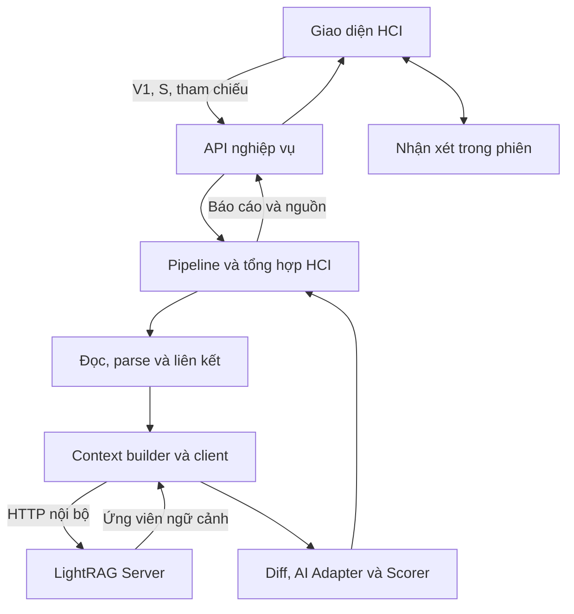

# Architecture — Kiến trúc hệ thống HCI

**Học phần và nhóm:** 2627I_INT2041_1 — Nhóm 6
**Dự án:** Hệ thống hỗ trợ đối chiếu thay đổi văn bản pháp luật với AI có giải thích và có sự kiểm chứng của người dùng
**Nhóm trưởng:** Bạch Công Dũng
**Thành viên:** Bạch Công Dũng, Dương Đức Anh, Lê Tùng Dương, Vương Thành Nam
**Phiên bản:** HCI 1.1.0
**Tài liệu liên quan:** [BRD](brd.md), [SRS](srs.md), [User Research](user-research.md), [Implementation Plan](implementation-plan-hci.md), [Owner Decisions](module-owner-decisions-hci.md)

## 1. Lựa chọn kiến trúc và hiện trạng

HCI tập trung vào người dùng sinh viên Luật: hiểu thay đổi, đọc bằng chứng, nhận biết giới hạn, ghi nhận nhận xét và kiểm tra lại sau bổ sung. Lõi xử lý V1–S cung cấp dữ liệu cho báo cáo, giao diện và đánh giá theo contract HCI. Chỉ tiêu chất lượng được xác định theo phạm vi và phép đo của hệ thống.

Frontend và backend nghiệp vụ được tách; backend xử lý trong cùng request, frontend giữ file, báo cáo và nhận xét trong phiên. Tạm chọn B: LightRAG Server riêng qua HTTP, có thể cùng máy localhost. Internet chỉ cần theo nơi chạy mô hình/tài nguyên; chưa cam kết offline toàn hệ thống. Phạm vi đầu tiên là retrieval, chưa giao LightRAG sinh ReviewItem hoàn chỉnh hoặc thay linker/scorer.

| Thành phần | Hiện trạng ZIP | Hướng mục tiêu / việc chờ owner |
| --- | --- | --- |
| PDF → DOCX, Parser | Có implementation xử lý đầu vào | Giữ code trước, thêm adapter nguồn; D-02 |
| API nền | Nhận doc_v1/doc_s/reference_files | Contract HCI baseline base_file/amendment_file/reference_files; D-01 |
| Pipeline nền | Đọc/parse, khung báo cáo hiện tại chưa đúng SRS HCI, điểm nối runner | Tổng hợp documents/items theo SRS HCI; validation lồng nhau chưa có |
| Context, schemas, change_analysis, evaluation | Thư mục khung | Bổ sung theo owner và fixture; chưa coi hoàn thành |
| Frontend | Khung, chưa có ứng dụng chạy hoàn chỉnh | React/TypeScript là định hướng tài liệu cũ, chi tiết D-07 |
| LightRAG | Chưa có client, chưa thử service trong ZIP | Release/API/model/index lifecycle theo D-04/D-05/D-13 |
| Test | Thư mục khung tên test/ | Giữ tên test/; owner bổ sung kiểm thử, không đổi tests/ riêng trong docs |

Ba file nền main/pipeline/requirements đã có trong ZIP, nhưng chưa đáp ứng schema HCI và thiếu runner phân tích. Đọc/parse hợp lệ hiện báo FAILED/ANALYSIS_NOT_CONFIGURED (HTTP 501). /health chỉ báo API và runner, chưa kiểm tra LightRAG. Chọn công nghệ hoặc có hook không chứng minh đã tích hợp hoặc nghiệm thu.

### Căn cứ hiện trạng mã nguồn

Đối chiếu mã [main tại commit 01b98ce](https://github.com/BACHCONGDUNG/legal-document-review-hitl/tree/01b98ced882787d5be63d14ca44b91c6aa795a59), chưa chạy kiểm thử trong đợt sửa tài liệu này:

- Converter, Parser và API/Pipeline nền có implementation; route upload và /health hiện ở backend/main.py. api/compare.py còn trống.
- contracts.py, config.py, adapter/linker, các file context/change_analysis và evaluator.py còn trống; frontend/test chủ yếu là khung. Có tên file không chứng minh chức năng hoàn thành.
- API nền còn doc_v1/doc_s/reference_files và report base_document/amendment_document/reference_documents/results; chưa là contract HCI mục tiêu.
- Mặc định chưa có analysis_runner; đọc/parse hợp lệ vẫn trả FAILED/ANALYSIS_NOT_CONFIGURED, API ánh xạ HTTP 501. requirements.txt có dependency; giới hạn mặc định trong code là cấu hình phát triển, chưa là số đo nghiệm thu.

## 2. Thành phần và ranh giới trách nhiệm



Các module nghiệp vụ gọi nhau bằng hàm/contract; HTTP LightRAG được cô lập trong client. Pipeline không phụ thuộc router hoặc shape response thô của dịch vụ. AI Adapter gọi mô hình và validate kết quả; context client không tự quyết định nhãn pháp lý hay decision người dùng. Log không ghi toàn văn tài liệu, ghi chú hoặc khóa.

| Thành phần | Trách nhiệm | Điểm bàn giao |
| --- | --- | --- |
| Xử lý đầu vào và document_adapter | Chuyển PDF khi cần, parse DOCX; giữ gốc/chuyển đổi, cây, bảng và outside | Dữ liệu nguồn theo document_id/source_ref; contract native/adapter chốt ở D-02 |
| Amendment linker | Trích chỉ dẫn, văn bản/đích, operation, applicability, trước/sau, hiệu lực | Dữ liệu để phân tích; chưa rõ giữ nguồn/lý do, không tự kết luận thêm/xóa |
| Chunk builder/source registry | Đoạn đủ nghĩa và ánh xạ nguồn | Chunk nội bộ có vai trò/định danh/spans; không coi là payload Server đã chốt |
| LightRAG client | Nhập, theo dõi sẵn sàng, query, lỗi và dọn dữ liệu | Ứng viên retrieval và trạng thái; API cụ thể D-04 |
| Context builder | Tìm căn cứ theo chỉ dẫn, kiểm tra quote và tài liệu | Ngữ cảnh, ReferenceRequirement, EffectInfo; nguồn vẫn thuộc V1/S/tham chiếu |
| Text Diff | Khác biệt chữ của trước/sau đủ căn cứ | TextChange khớp chuỗi trả frontend |
| Semantic Diff / Scorer / AI Adapter | Nhận định bốn nhóm, giải thích, mức tác động; kiểm tra cấu trúc và quote | Dữ liệu chuyển sang ReviewItem theo SRS, không dùng điểm retrieval làm significance |
| Bộ tổng hợp HCI | Giữ cả chỉ dẫn chưa phân tích được, mapping nội bộ và lỗi | ComparisonReport có documents/items và nguồn dùng được |
| Frontend/session | Hiển thị, lọc, ReviewRecord, đối chiếu sau phân tích lại | Dữ liệu người dùng riêng, không ghi đè AI hoặc tự thành gold |

## 3. Cấu trúc mã nguồn và dữ liệu

Dùng backend/app/, không tạo lại src/ Python. Cây dưới ghi ranh giới mục tiêu; ngoài hai file xử lý đầu vào và ba file nền, các tên file mới là đề xuất tổ chức chờ owner hiện thực, không xác nhận đã tồn tại.

```text
.
├── backend/
│   ├── main.py
│   └── app/
│       ├── pipeline.py
│       ├── api/
│       │   └── compare.py
│       ├── schemas/
│       │   └── contracts.py
│       ├── config.py
│       ├── document_processing/
│       │   ├── pdf_to_docx.py
│       │   ├── parser/
│       │   │   └── legal_structure_parser.py
│       │   ├── document_adapter.py
│       │   └── amendment_linker.py
│       ├── context/
│       │   ├── chunk_builder.py
│       │   ├── source_registry.py
│       │   ├── lightrag_client.py
│       │   └── context_builder.py
│       ├── change_analysis/
│       │   ├── text_diff.py
│       │   ├── semantic_diff.py
│       │   ├── scorer.py
│       │   └── ai_adapter.py
│       └── evaluation/
│           └── evaluator.py
├── frontend/
├── test/
│   ├── unit/
│   ├── integration/
│   ├── e2e/
│   └── fixtures/
├── data/
│   ├── raw/
│   │   └── case_*/
│   ├── test_parser/
│   └── test_pdf_to_docx/
├── deploy/
│   └── lightrag/
├── runtime/
└── docs/
```

Parser hiện tự đọc DOCX, trả dict gồm articles/outside/source_blocks/warnings/status/summary. Node giữ children, segments, full_text, source_refs; không là knowledge graph. Giữ implementation trước, chưa bắt refactor Reader riêng; Dũng đề xuất adapter và mapping để Đức Anh/Nam dùng được. Reference không có Điều nhưng có blocks/bảng vẫn có thể làm căn cứ; native Parser status không thay ComparisonReport.status.

Source_ref hiện là block:N. Offset segment tính theo ký tự Python [start,end) trên text block; node_id không là khóa ghép phiên bản. Với PDF chuyển đổi, chỉ nói đúng nguồn DOCX đã có; mapping trang PDF là đầu ra cần kiểm chứng, không suy từ số block. D-02/D-07 phải xử lý chuyển chỉ số khi frontend dùng quy ước khác.

Chunk nội bộ dự kiến có comparison_id, document_id, role, unit_path, node_ids, text, source_spans và ID nhóm quản lý. Owner quyết định kích thước/cách ghép ở D-04; không lấy full_text mọi cấp gây lặp hoặc chỉ node lá làm mất câu dẫn. Không mặc định Server nhận cây dict, giữ metadata hoặc không chia lại chunk. Registry phải nối kết quả query với nguyên văn đã cung cấp.

## 4. Luồng phân tích, dữ liệu và phiên

### 4.1. Một lượt phân tích

1. Frontend gửi base_file/amendment_file/reference_files theo baseline SRS; API nền phải được chuyển đổi trước tích hợp HCI.
2. Backend cấp comparison_id mới, kiểm tra/lưu file tạm và chạy pipeline. Chuẩn bị nguồn/cây bằng converter/Parser hiện có, adapter theo D-02.
3. Linker trích yêu cầu và đích; chuẩn bị chỉ mục một lần cho bộ tài liệu trong comparison, chờ nhập hoàn tất rồi mới query.
4. Context builder truy vấn theo yêu cầu, kiểm tra nguồn, ghi căn cứ thiếu/chưa rõ và EffectInfo. Retrieval score hoặc mô tả entity không thay severity/quote.
5. Text Diff chạy khi đủ trước/sau. Semantic Diff/Scorer tạo dữ liệu có căn cứ; bộ tổng hợp chuyển thành ReviewItem, bốn mã HCI và ComparisonReport theo SRS.
6. Trả nguồn đủ cho frontend đọc bằng chứng sau khi backend dọn tài nguyên. Chưa tạo được nhận định vẫn giữ mục chỉ dẫn và lý do; không che lỗi bằng mảng rỗng.
7. Frontend khởi tạo UNREVIEWED, cho người dùng kiểm chứng và lưu decision/note. Nhận xét không đi ngược thành đáp án AI tự động.

Chỉ mục phục vụ nhiều chỉ dẫn trong một comparison, chưa giữ qua request bổ sung. D-04 phải kiểm chứng nhập/status/query/mapping/cách ly/xóa ở release cố định. Nếu chưa làm được vòng đời này, chỉ thử một bộ trong môi trường disposable riêng; chưa coi đạt yêu cầu phục vụ nhiều lượt/người dùng.

### 4.2. Bổ sung tài liệu và nhận xét

Gửi lại V1/S cùng tham chiếu cũ/mới trong request đồng bộ mới. Frontend giữ báo cáo/nhận xét cũ và tạm khóa sửa/lưu trong khi chờ; thất bại giữ nguyên bản cũ. Lượt có kết quả dùng được tuân SRS: mục mới UNREVIEWED; cùng mục nhưng nội dung đổi RECHECK_REQUIRED, decision hiện tại null và previous_record giữ riêng; chỉ giữ REVIEWED khi xác minh nội dung liên quan không đổi. Không ghép chắc chắn thì giữ nhận xét cũ trong danh sách chưa đối chiếu, không gắn theo số Điều/thứ tự hoặc ID giống nhau.

Lượt mới PARTIAL nhưng dùng được vẫn cần xử lý đối chiếu; FAILED/timeout không thay báo cáo cũ. SRS quy định hành vi, D-08 chốt thuật toán/mapping/fixture. Khi chưa chứng minh mapping, dùng phương án yêu cầu kiểm tra lại mọi mục cũ nhận diện được, giữ riêng các mục không ghép được.

### 4.3. Vị trí lưu và vòng đời

| Dữ liệu | Nơi giữ | Vòng đời |
| --- | --- | --- |
| File đã chọn, report/nguồn, ReviewRecord | Frontend | Trong phiên; chưa bảo đảm sau đóng/tải lại tab; cảnh báo trước đổi phiên |
| File gốc/chuyển đổi dùng xử lý | Backend runtime | Theo comparison; dọn khi không còn tác vụ dùng, kể cả lỗi |
| Chỉ mục và cache chứa nội dung | LightRAG/storage đã cấu hình | Cách ly và dọn theo comparison phải kiểm chứng; Server chạy liên tục không có nghĩa dữ liệu được giữ lâu dài |
| Nhãn/gold và dữ liệu nghiên cứu | Bộ dữ liệu được quản lý riêng | Không nhập nhãn, V2 đối chiếu hoặc dữ liệu người dùng vào index ngoài chủ định |
| Log | Backend/dịch vụ | ID, bước, lỗi, thời gian; giới hạn lưu chờ D-09/D-13; không toàn văn/ghi chú/khóa |

Không xóa vùng dùng chung của Server để giả lập xóa một comparison. HTTP timeout không tự hủy converter/tác vụ phía dịch vụ. Cần xử lý dữ liệu sót hoặc tác vụ tiếp tục chạy; retry có giới hạn, không tự gửi lặp toàn POST từ frontend.

## 5. API, lỗi và contract

API nghiệp vụ mục tiêu: POST /api/compare, multipart base_file/amendment_file/reference_files, trả ComparisonReport HCI và nguồn. Chưa có API lưu nhận xét/job. Mã HTTP/error body, kích thước và alias nếu muốn hỗ trợ được phối hợp theo D-01/D-02 trong api-contract.md (Dũng + Đức Anh cùng biên soạn, chưa có trong gói). Cơ chế giữ/đọc bằng chứng do Tùng Dương quyết định theo D-07, phối hợp Đức Anh về API và Dũng về nguồn; thay contract hoặc vòng đời cần các bên liên quan review. Không ghi URL/payload LightRAG chưa kiểm chứng như API chính thức của dự án.

Code nền vẫn dùng doc_v1/doc_s và cấu trúc báo cáo chưa đúng SRS; việc tài liệu thống nhất không tự sửa code. Bộ tổng hợp chuyển đổi nội bộ sang HCI; thiếu module hiện trả 501/ANALYSIS_NOT_CONFIGURED. Mã này là trạng thái phát triển, không phải kết luận “không có thay đổi”. SUCCESS/PARTIAL/FAILED, needs_review và ReviewRecord là ba tầng khác nhau.

Với lỗi từng bước, giữ chỉ dẫn/căn cứ đã có và chỉ PARTIAL khi có kết quả dùng được; không có thì FAILED. Lỗi retrieval không tạo REFERENCE_MISSING chỉ vì query rỗng. Có file nhưng chưa tìm đúng đoạn là UNRESOLVED. Ngoài bốn nhóm giữ nguồn, nêu OUT_OF_SCOPE, không ép nhãn hoặc false/LOW.

## 6. Chủ trì và lựa chọn còn mở

| Owner | Trách nhiệm theo kế hoạch HCI | Quyết định liên quan |
| --- | --- | --- |
| Bạch Công Dũng | Đầu vào, dữ liệu, nghiên cứu người dùng và điều phối | D-02, D-10, D-12 |
| Dương Đức Anh | Backend, linker, context và tích hợp/vận hành | D-01, D-03, D-04, D-09, D-13 |
| Lê Tùng Dương | Tương tác, frontend và session/nhận xét | D-07, D-08 |
| Vương Thành Nam | Diff, AI Adapter, Scorer và đánh giá kỹ thuật | D-05, D-06, D-11 |

[Module Owner Decisions](module-owner-decisions-hci.md) là nơi duy nhất theo dõi phương án và trạng thái, chia thành phần owner và phần cần nhiều bên thống nhất theo cùng D-ID. Nam quyết định chính D-05; Đức Anh quyết định chính D-04/D-13; Tùng Dương quyết định cơ chế đọc bằng chứng D-07. Dũng + Đức Anh cùng biên soạn api-contract.md/development-guide.md; Dũng tổng hợp kế hoạch và báo cáo đánh giá chung. Các phương án kỹ thuật vẫn chờ owner lựa chọn và review theo phạm vi ảnh hưởng. Đổi thuật toán nội bộ do owner đề xuất và tự kiểm tra; đổi contract phải được bên giao/nhận review fixture. Sau chốt, cập nhật SRS/Architecture/hướng dẫn tương ứng, không giữ nhiều bảng quyết định mâu thuẫn.

Không triển khai thêm database lịch sử, account, cộng tác, job/queue hoặc học lại từ nhận xét ở đợt này. Đánh giá kỹ thuật do Nam chủ trì; Dũng chủ trì usability; không lấy chất lượng mô hình làm bằng chứng giao diện hiệu quả hoặc ngược lại. React/TypeScript là định hướng đã ghi trong bản cũ, D-07 xác nhận môi trường và thư viện; giới hạn, mô hình và ngân sách chưa là cam kết.
